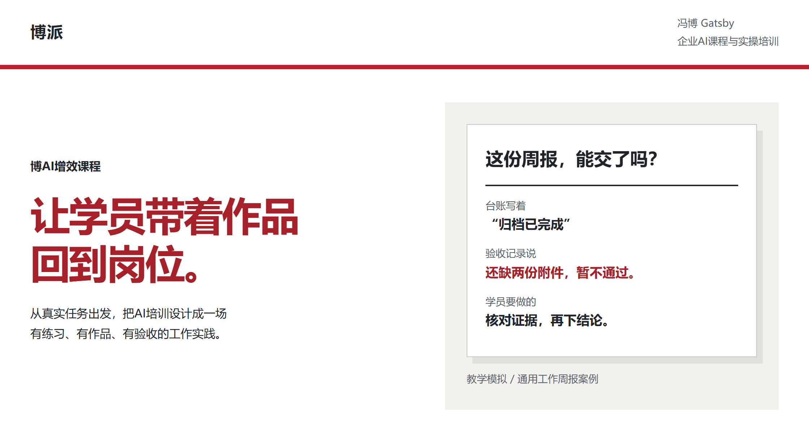
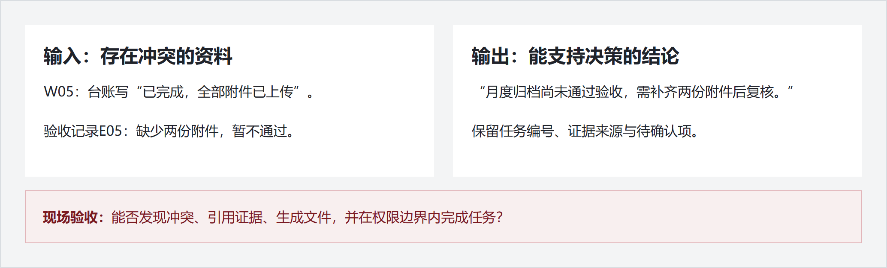

# 博AI增效课程 Skill 套件

<picture>
  <source media="(max-width: 600px)" srcset="assets/readme/hero-mobile.png">
  
</picture>

**从真实任务出发，把AI培训设计成有练习、有作品、有验收的工作实践。** 七项课程设计Skill，连接课前需求、课堂实操和课后改进。

[看完整教学案例](examples/weekly-report-pcr.md) · [安装与使用指南](GUIDE.md) · [联系冯博](mailto:fengbo.football@foxmail.com)

## 看一个案例，再理解我们怎么设计课

**任务：把零散工作记录，做成主管能据此决策的一页周报。**

<picture>
  <source media="(max-width: 600px)" srcset="assets/readme/case-mobile.png">
  
</picture>

学员要交出工作周报与证据核查表，再把方法固化成可复用流程。小组轮换操作、核查和主管角色，展示作品后继续修改。

**现场验收：**是否发现事实冲突？是否引用证据？是否生成可用文件？是否遵守读写与发送权限？换一组资料还能否完成？

[打开完整案例：材料、任务、教练说明与验收标准](examples/weekly-report-pcr.md)

这是已公开的教学模拟草案，不是客户真实记录；未宣称已完成课堂试讲或所有工具的端到端实测。

## 把抽象概念，变成看得见的操作

已有教学图示，用于展示课程的表达方式；风格参考来源与许可见 boai-ppt 对应说明。

## 课前、课堂、课后，各有清晰的交付

| 阶段 | 先回答的问题 | 可设计的交付物 |
|---|---|---|
| 课前 | 谁来学？要完成什么岗位任务？ | 学员调研、需求分析、定制课纲 |
| 课堂 | 怎样动手？怎样发现并修正错误？ | 实操案例、练习材料、作品与验收清单 |
| 课后 | 什么值得保留？下一次怎么改？ | 授课复盘、改进建议、可复用模板 |

具体范围根据客户需求、课时、材料与预算确定。

> 更少的概念、工具与技巧；更多的实操、作品与产出。  
> **No tell, just show.**

## 七项能力，按任务组合

| 你需要做什么 | 使用哪个Skill |
|---|---|
| 了解学员基础与岗位需求，形成分析报告 | [课前问卷与分析](boai-questionnaire/SKILL.md) |
| 把需求转成具体课纲与Word/PDF | [课纲定制](boai-kegang/README.md) |
| 设计学员材料、教练说明与验收标准 | [业务案例制作](boai-showcase/README.md) |
| 准备标注清楚的教学模拟数据 | [教学数据案例](boai-zengxiao-data-case/README.md) |
| 将确认后的脚本做成教学课件 | [教学PPT](boai-ppt/README.md) |
| 从授课录音中提炼案例与改课建议 | [讲课录音复盘](boai-recording-review/SKILL.md) |
| 检查课程是否坚持用户导向、实操与产出 | [课程价值观](boai-course-value/SKILL.md) |

## 安装：把需要的目录交给Agent

> 请安装 https://github.com/Captainf5/boai-course 中的 boai-kegang，保留完整配套文件，核对依赖，不覆盖我的个人配置和业务文件。

也可下载仓库，将选定的完整目录放入宿主Skill目录。不要只复制SKILL.md。[完整安装、自然语言用法与依赖说明](GUIDE.md)。

使用前：账号、数据、版本与验证边界

Skill源码公开不等于所有外部服务已接通。飞书、邮件、录音接口和模型能力依赖使用者自己的授权；客户原件、邮箱配置和凭据不随安装包提供。真实客户项目的端到端验收范围，以各项说明为准。

通用数据分析属于独立的 [bobo-data-analysis](https://github.com/Captainf5/bobo-data-analysis)，不混入课程设计套件。问卷分析调用的归藏PPT与教学课件制作分开。

[完整使用指南](GUIDE.md) · [版本与验证边界](VERSIONS.md) · [发布验证](PUBLICATION.md) · [历史迁移](MIGRATION.md)

GitHub发布与SkillHub上架分别验收；本页不表示SkillHub已上架，也不承诺课堂业务效果。

## 说一个你们想解决的工作问题

来信说明：**团队与岗位、希望完成的任务、理想产物、学员人数与基础、预计培训时间**。我们据此讨论课程范围和准备材料。

**商务联系：[fengbo.football@foxmail.com](mailto:fengbo.football@foxmail.com)**

首次沟通不需要提供密码、账号凭据或未经批准外传的业务资料。

[返回冯博的项目主页](https://github.com/Captainf5)

页面设计方法参考 [花叔 huashu-design](https://github.com/alchaincyf/huashu-design)。页面内容与教学案例来自博派；示例不作为客户效果承诺。
